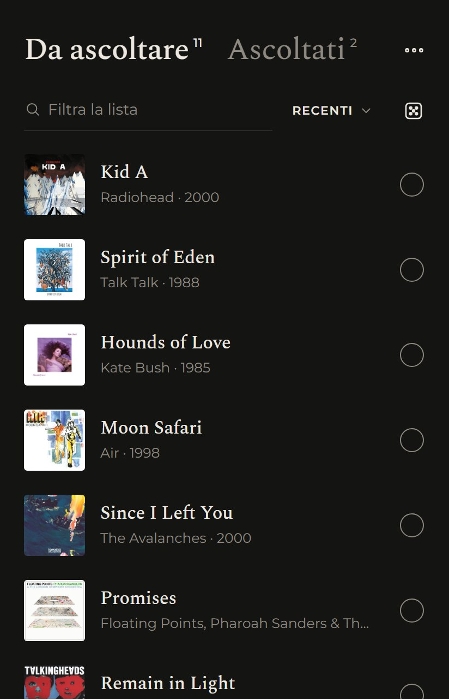
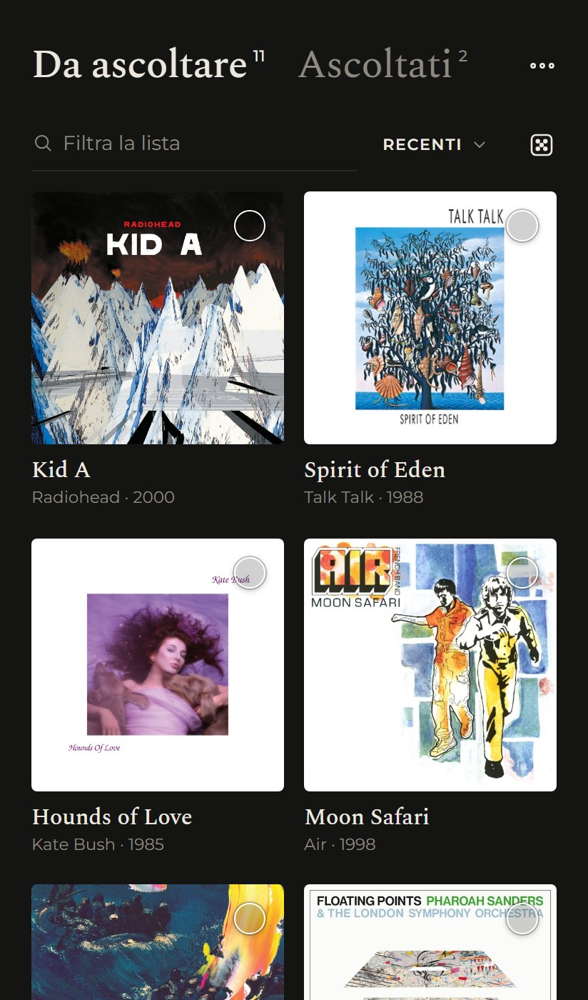
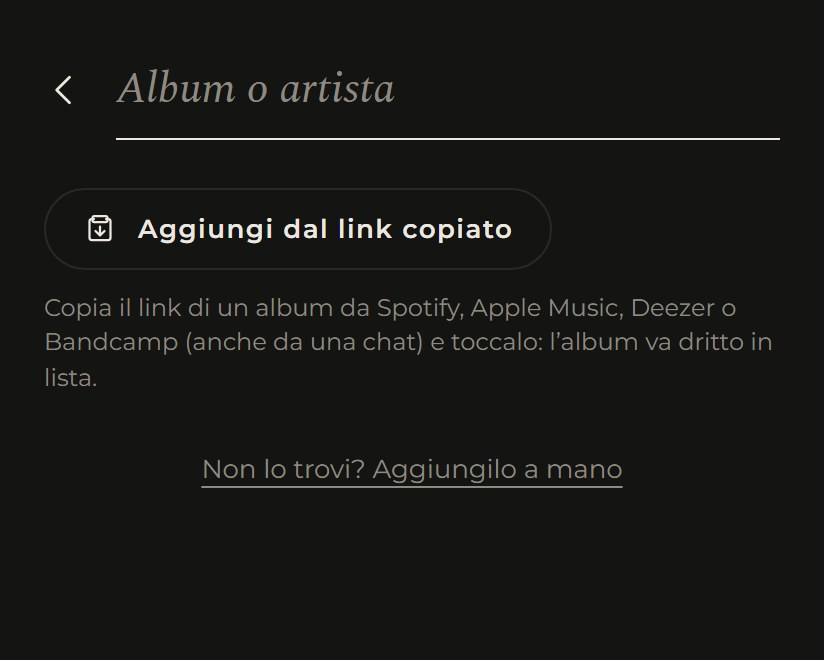
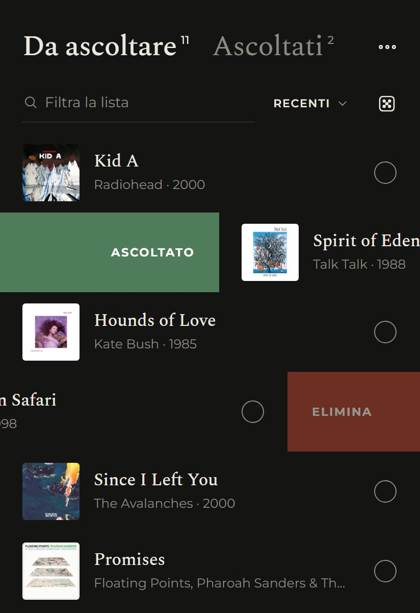
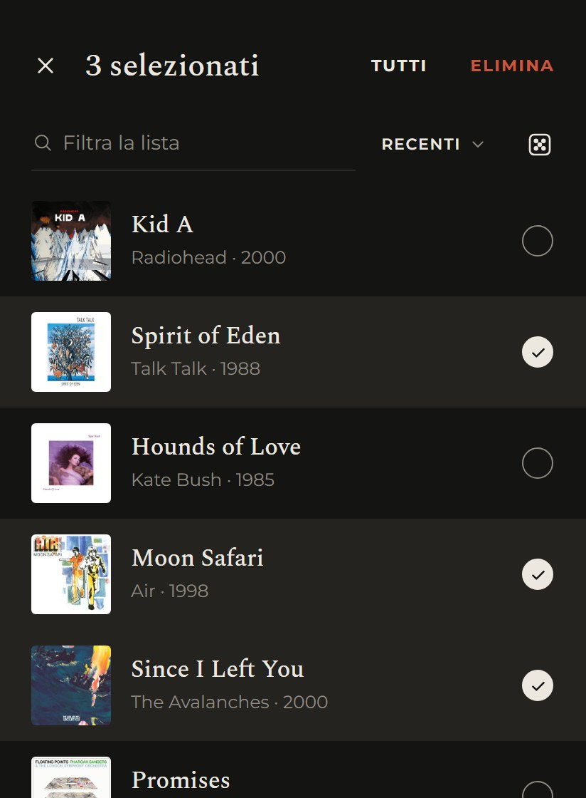
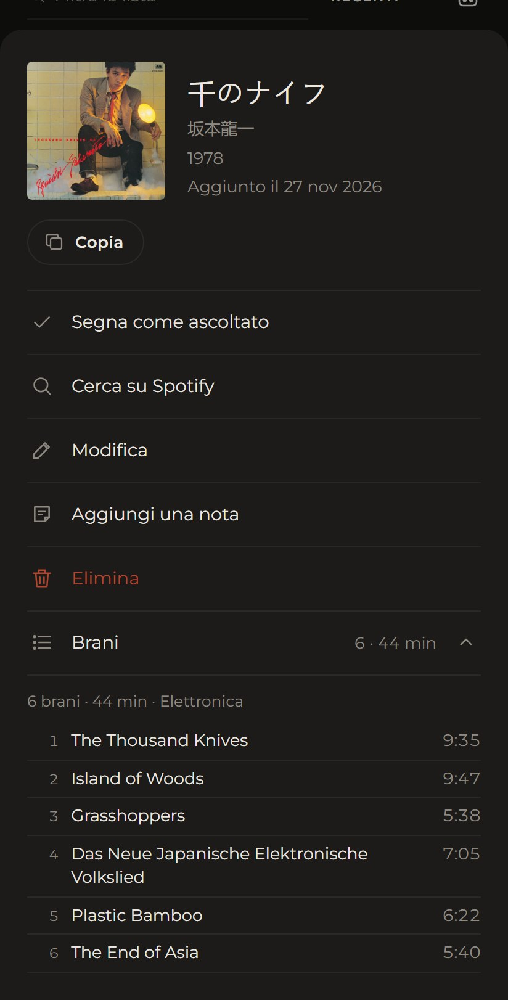
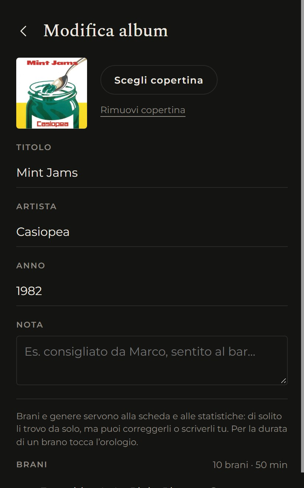
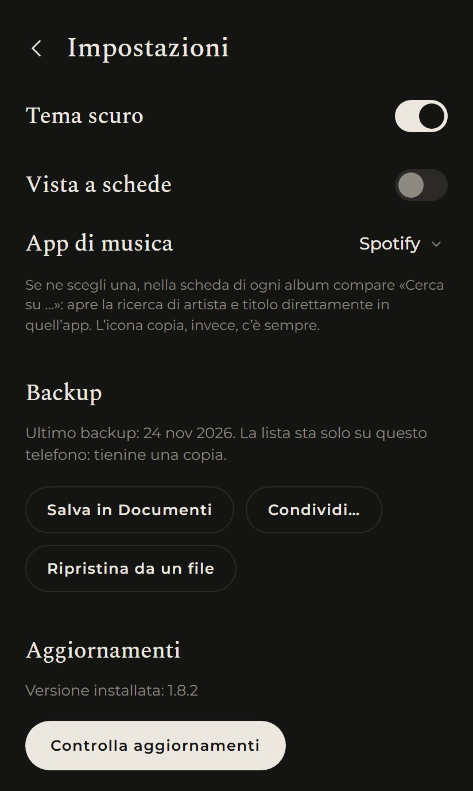

# Ascolti

Una lista minimale degli album che vuoi ascoltare. Li aggiungi, li spunti man mano che li ascolti e ti ricordi cosa ti manca.

Per ogni album l'app tiene solo **copertina, titolo, artista e anno**. Dove ascoltarlo lo scegli tu: Ascolti non ti chiede nessun account e non si collega al tuo Spotify o ad altri servizi. Se vuoi, però, può aprire la ricerca di un album nella tua app di musica preferita.


<p align="center">
  
  
  
</p>

## Cosa fa

### Aggiungere un album

- **Cerca**: tocca **+** e scrivi titolo o artista. L'app cerca insieme nel catalogo di Apple (iTunes), su Deezer e su MusicBrainz, che ha anche le uscite più rare. Mette in cima gli album che corrispondono meglio a quello che hai scritto, e subito sotto le altre edizioni (*Live*, *Remastered*…). La **x** nella barra cancella la ricerca per farne un'altra.
- **Dal link copiato**: copia il link di un album (per esempio da una chat), tocca **+** e poi **Aggiungi dal link copiato**. L'album va dritto in *Da ascoltare*, con *Annulla*. Funziona con link di Spotify, Apple Music, Deezer e Bandcamp; se l'album c'è già, l'app te lo dice.
- **Da altre app**: da Spotify, Apple Music, Deezer, Bandcamp o dal browser tocca *Condividi* → **Ascolti**. L'album letto dal link compare in cima ai risultati, segnato *dal link*, con sotto la ricerca normale nel caso abbia letto male. Con i siti che non riconosce, l'app cerca il titolo della pagina.
- **A mano**: se non lo trovi, *Non lo trovi? Aggiungilo a mano*. Puoi scegliere anche la copertina tra quelle trovate.

<p align="center">
  
  
  
</p>

### La lista

- **Due liste**: *Da ascoltare* e *Ascoltati*. Tocca il cerchio accanto a un album per spuntarlo; se sbagli, tocca *Annulla*.
- **Gesti** (vista a lista): scorri un album **verso destra** per segnarlo come ascoltato (in *Ascoltati*: per rimetterlo da ascoltare) e **verso sinistra** per eliminarlo, sempre con *Annulla*.
- **Filtra e ordina**: sopra ciascuna lista c'è un campo che filtra mentre scrivi (titolo, artista o anno, anche insieme: "radiohead 2001"). Accanto c'è **Ordina**: aggiunti o ascoltati di recente, artista, titolo, anno dal più vecchio o dal più nuovo. Nell'ordine per artista "The" viene ignorato; gli album senza anno vanno in fondo.
- **Cosa ascolto adesso?**: il **dado** pesca un album a caso tra quelli da ascoltare (se hai scritto un filtro, tra quelli filtrati). Non ti convince? *Pesca un altro*.
- **Eliminare più album insieme**: tieni premuto un album, tocca gli altri (o *Tutti*) e poi **Elimina**, con *Annulla*.
- **Lista o schede**: da *Impostazioni → Vista a schede* le copertine si vedono in griglia, 2 o 3 per riga.
- Mentre scorri, schede, filtro e ordinamento restano in alto.

<p align="center">
  
  
  
</p>
<p align="center">
  
  
</p>

### La scheda dell'album

Tocca un album per aprirne la scheda:

- **Segna come ascoltato** (o rimettilo tra quelli da ascoltare).
- **Copia**: l'icona accanto al titolo mette negli appunti artista e titolo, pronti da incollare dove vuoi. È comoda con i nomi in caratteri che non sai scrivere, come i kanji.
- **Cerca su …**: se in *Impostazioni → App di musica* hai scelto la tua app, la apre già sulla ricerca dell'album. Le app disponibili sono Spotify, Apple Music, YouTube Music, Deezer, Tidal, Amazon Music, Bandcamp e SoundCloud; se l'app non è installata si apre il sito.
- **Modifica**: titolo, artista, anno e copertina, da scegliere tra quelle trovate su iTunes, Deezer e MusicBrainz.
- **Elimina**.

<p align="center">
  
  
  
</p>

### Impostazioni

Dai tre puntini in alto a destra:

- **Tema scuro** (predefinito) o chiaro.
- **Vista a schede** e **Schede per riga**.
- **App di musica** per *Cerca su …* (predefinito: nessuna).
- **Backup** e **Aggiornamenti** (vedi sotto).

<p align="center">
  
  
</p>

## Installazione

Ascolti non è sul Play Store: si installa scaricando il file dell'app (un APK) da questa pagina. Serve **Android 7 o più recente**.

1. **Sul telefono**, apri la pagina **[dell'ultima versione](https://github.com/dariotronic/ascolti-todo/releases/latest)** e tocca il file **`Ascolti.apk`** in fondo, sotto *Assets*.
2. Quando il download è finito, tocca la notifica o apri il file dai *Download*.
3. La prima volta Android ti chiede di **consentire l'installazione di app da questa origine** (il browser, per esempio Chrome): tocca *Impostazioni*, attiva *Consenti da questa origine* e torna indietro.
4. Tocca **Installa**.
5. Probabilmente comparirà **Google Play Protect** (vedi sotto). Se decidi di procedere, tocca *Altri dettagli* → **Installa comunque**.
6. Apri **Ascolti** e tocca **+** per aggiungere il primo album.

### L'avviso di Play Protect

Play Protect controlla le app che non arrivano dal Play Store. Con Ascolti può mostrare *"App non riconosciuta"* oppure *"App dannosa bloccata"*.

Google non spiega il secondo avviso, che spaventa, ma il motivo più probabile è questo: Ascolti sa **scaricare e installare i propri aggiornamenti** senza passare dal Play Store, e i controlli automatici di Google trattano con sospetto le app installate a mano che lo fanno. L'app può installare **solo una versione più nuova di sé stessa**, firmata con la stessa chiave e presa da questa pagina.

Non legge contatti, foto, posizione o altri dati del telefono. **Il codice è tutto pubblico, qui.** Detto questo, la scelta è tua: se l'avviso ti mette a disagio, non installarla.

### Aggiornamenti

Quando apri l'app, Ascolti controlla se c'è una versione nuova, al massimo una volta l'ora. Se c'è, in cima alla lista compare **"Nuova versione disponibile · Aggiorna"**. Tocca *Aggiorna*: l'app la scarica, mostra l'avanzamento e apre l'installazione, senza perdere i dati.

- La prima volta Android ti chiede di **consentire ad Ascolti di installare app**: attiva l'opzione e torna indietro, l'installazione riparte da sola.
- Anche qui può comparire Play Protect: *Altri dettagli* → *Installa comunque*.
- Puoi controllare anche a mano da *Impostazioni → Controlla aggiornamenti*.

<p align="center">
  
</p>

### Backup e cambio di telefono

I dati stanno **solo sul telefono**: se disinstalli l'app o ne cancelli i dati, la lista si perde. Per salvarla, da *Impostazioni → Backup*:

- **Salva in Documenti**: crea il file `ascolti-backup-AAAA-MM-GG.json` nella cartella *Documenti/Ascolti* del telefono.
- **Condividi…**: manda lo stesso file dove vuoi (Drive, mail, Telegram…).
- **Ripristina da un file**: scegli un file di backup, anche su un altro telefono. Gli album già presenti non vengono duplicati.

Se non fai un backup da più di un mese, l'app te lo ricorda in cima alla lista (*Più tardi* lo rimanda di una settimana).

### Privacy

- Niente account, niente pubblicità, niente statistiche d'uso. La lista resta sul telefono.
- Quando cerchi, il testo che scrivi viene inviato ad Apple (iTunes), Deezer e MusicBrainz per trovare gli album; da lì arrivano anche le copertine.
- Quando aggiungi da un link (copiato o condiviso), l'app apre quella pagina per leggerne titolo, artista, anno e copertina.
- Gli appunti vengono letti solo quando tocchi *Aggiungi dal link copiato*; con *Copia* l'app ci scrive artista e titolo.
- *Cerca su …* apre la tua app di musica (o il suo sito) con artista e titolo dell'album.
- Per gli aggiornamenti l'app legge l'elenco delle versioni da GitHub.

### Riconoscimenti

Dati degli album da [iTunes Search](https://performance-partners.apple.com/search-api), [Deezer](https://developers.deezer.com/api), [MusicBrainz](https://musicbrainz.org) e [Cover Art Archive](https://coverartarchive.org). Caratteri [Spectral](https://fonts.google.com/specimen/Spectral) e [Montserrat](https://fonts.google.com/specimen/Montserrat) (licenza SIL Open Font).

Made with 🪗 by [@dariotronic](https://www.instagram.com/dariotronic/).

---

# Per chi sviluppa

App [Capacitor 8](https://capacitorjs.com) con HTML, CSS e JS senza framework e senza bundler, in `www/`. Pacchetto Android `it.dariotronic.ascolti`.

## Struttura

- `www/`: l'app (`index.html`, `style.css`, `app.js`, caratteri in `fonts/`). Per vederla basta aprire `index.html` nel browser; lì i dati finiscono in `localStorage` e i plugin nativi mancano: niente aggiornamenti né Condividi, e il backup si scarica.
- `android/`: il progetto Android generato da Capacitor, con due plugin dell'app (non da npm), registrati in `MainActivity.java`:
  - [`ApkUpdaterPlugin.java`](android/app/src/main/java/it/dariotronic/ascolti/ApkUpdaterPlugin.java): scarica e installa gli aggiornamenti (vedi sotto).
  - [`ShareReceiverPlugin.java`](android/app/src/main/java/it/dariotronic/ascolti/ShareReceiverPlugin.java): riceve il testo condiviso da altre app (*Condividi → Ascolti*, intent `SEND` `text/plain`). Lo passa al JavaScript con `consume()` all'avvio e con l'evento `shared` ad app aperta.
  - `build.gradle` ricava `versionName`/`versionCode` da `package.json` (1.2.3 → 10203).
- `.github/workflows/release.yml`: compila, firma e pubblica le release.
- `build.sh` / `release.sh`: compilazione locale e avvio del workflow di release.

Plugin di Capacitor usati: `App`, `Preferences` (dati e impostazioni), `Filesystem` e `Share` (backup), `Clipboard` (copia e link copiato). Il `fetch` passa da `CapacitorHttp`, che evita i limiti CORS.

Permessi Android: `INTERNET`, `REQUEST_INSTALL_PACKAGES` (aggiornamenti) e, solo fino ad Android 10, lettura e scrittura della memoria per il backup in Documenti. Il FileProvider espone solo `cache/updates` e `cache/backup`.

## Ricerca

Le tre fonti (iTunes Search, Deezer, MusicBrainz) vengono interrogate in parallelo, 25 risultati ciascuna, e la lista si aggiorna man mano che rispondono. Lo stesso album trovato su più fonti diventa un solo risultato: copertina da iTunes o Deezer, anno più vecchio, cioè quello dell'uscita originale. L'ordine dipende da:

- quante parole cercate compaiono in titolo e artista;
- titolo senza parole in più;
- edizioni (*Live*, *Remastered*, anni…) subito sotto l'album;
- singoli ed EP dopo gli album;
- album conosciuti da più fonti prima.

MusicBrainz accetta una richiesta al secondo: se risponde 503, l'app riprova una volta.

## Lettura dei link

Usata da *Aggiungi dal link copiato* e da *Condividi → Ascolti*. L'app scarica la pagina presentandosi come Chrome per Android e ne legge i metadati (`og:title`, `og:description`, `og:image`, `music:release_date`), con regole diverse per Spotify (album e brani), Apple Music, Deezer e Bandcamp.

- Il sito si riconosce dal link, non dall'indirizzo finale: dal telefono Spotify può reindirizzare a `spotify.app.link`.
- Dai link di Spotify si toglie `?si=…` e si aggiunge `nd=1`, così la pagina non rimanda all'app.
- L'identità di un link ignora parametri e `intl-xx`, così lo stesso album copiato due volte risulta già in lista.
- Per gli altri siti, o se la pagina non si legge (Bandcamp a volte risponde con un controllo anti-bot), si cerca il titolo della pagina o le parole dell'indirizzo.

## Aggiornamenti dentro l'app

All'avvio (e al ritorno in primo piano, al massimo una volta l'ora) l'app legge l'ultima release di questa repo. Il plugin può installare **solo una versione più nuova di Ascolti stessa**:

- scarica solo dalle release di `dariotronic/ascolti-todo` (file `.apk`, al massimo 100 MB);
- confronta l'impronta SHA-256 dichiarata da GitHub;
- prima di installare controlla nome del pacchetto, versione e firma;
- installa solo file della propria cartella degli aggiornamenti.

## Pubblicare una nuova versione

La release si compila e si firma su GitHub Actions ([`release.yml`](.github/workflows/release.yml)), con la chiave salvata nei secret della repo: non serve un PC in particolare.

- **Dal sito**: *Actions* → *Release* → *Run workflow*, scrivi versione (es. `1.9.0`) e note.
- **Da Git Bash**, dopo aver fatto commit delle modifiche:

  ```bash
  ./release.sh 1.9.0 "Cosa cambia"
  ```

Il workflow:
1. aggiorna la versione in `package.json`;
2. compila;
3. verifica che l'APK sia firmata con la chiave di Ascolti;
4. fa commit e tag `vX.Y.Z`;
5. crea la release con `Ascolti.apk` allegata.

Con *Solo prova* compila e verifica senza pubblicare.

Secret della repo: `KEYSTORE_BASE64` (il file `.jks` in base64), `KEYSTORE_PASSWORD`, `KEY_ALIAS`, `KEY_PASSWORD`.

## Compilare in locale

Servono JDK 21 e Android SDK (platform 36). Poi `./build.sh` produce `Ascolti.apk`, firmata se sul PC c'è la chiave (vedi sotto).

Per installarla via USB: `adb install -r Ascolti.apk`.

Per fare debug della WebView su una build firmata, aggiungi temporaneamente `"android": { "webContentsDebuggingEnabled": true }` a `capacitor.config.json`, compila con `./build.sh` e collegati da `chrome://inspect`. Poi togli l'opzione: le release non devono averla.

## Screenshot del README

Le immagini in `docs/screenshots/` sono l'app vera (`www/`) con dati di esempio, catturata da Edge senza finestra con uno schermo da telefono emulato (412 px, densità 2):

```bash
node tools/screenshots/capture.mjs "$PWD/www" "$PWD/docs/screenshots" "$PWD/tools/screenshots/demo.json"
```

`demo.json` contiene gli album di esempio, con le copertine da iTunes. `extra.json` contiene i risultati di ricerca e le copertine mostrate nelle schermate di ricerca. Le scene, cioè cosa aprire e quale zona ritagliare, sono in fondo a `capture.mjs`.

## Firma

Le release sono firmate con una chiave dedicata, **tenuta fuori dalla repo**: `ascolti-todo-release.jks` più `keystore.properties` con le password. Gradle la cerca in `~/.keystores/ascolti-todo/keystore.properties`, oppure nel percorso indicato dalla variabile `ASCOLTI_KEYSTORE_PROPS`.

La stessa chiave è nei secret della repo per il workflow, ma da lì **non si può rileggere**: tienine una copia di sicurezza. Senza la stessa chiave gli aggiornamenti non si installano sopra l'app esistente.
