# Ascolti

Una lista minimale degli album che vuoi ascoltare. Li aggiungi, li spunti man mano che li ascolti e ti ricordi cosa ti manca.

Per ogni album l'app tiene solo **copertina, titolo, artista e anno**. Dove ascoltarlo lo scegli tu: Ascolti non ti chiede nessun account e non si collega al tuo Spotify o ad altri servizi. Se vuoi, però, può aprire la ricerca di un album nella tua app di musica preferita.

**Indice**

- [Cosa fa](#cosa-fa)
  - [Aggiungere un album](#aggiungere-un-album): [Cerca](#cerca) · [Dal link copiato](#dal-link-copiato) · [Da altre app](#da-altre-app) · [A mano](#a-mano)
  - [La lista](#la-lista): [Da ascoltare e Ascoltati](#da-ascoltare-e-ascoltati) · [Annulla](#annulla) · [Gesti](#gesti) · [Filtra e ordina](#filtra-e-ordina) · [Cosa ascolto adesso?](#cosa-ascolto-adesso) · [Preferiti](#preferiti) · [Più album insieme](#più-album-insieme) · [Lista o schede](#lista-o-schede)
  - [La scheda dell'album](#la-scheda-dellalbum): [Brani](#brani) · [Nota](#nota) · [Copia e Cerca su …](#copia-e-cerca-su-) · [Modifica](#modifica)
  - [Statistiche](#statistiche)
  - [Impostazioni](#impostazioni): [Tema e testo](#tema-e-testo) · [App di musica](#app-di-musica)
- [Installazione](#installazione)
  - [L'avviso di Play Protect](#lavviso-di-play-protect)
  - [Aggiornamenti](#aggiornamenti)
  - [Backup e cambio di telefono](#backup-e-cambio-di-telefono)
  - [Privacy](#privacy)
  - [Riconoscimenti](#riconoscimenti)
- [Per chi sviluppa](#per-chi-sviluppa)
  - [Struttura](#struttura) · [Dati](#dati) · [Ricerca](#ricerca) · [Lettura dei link](#lettura-dei-link) · [Copertine salvate](#copertine-salvate) · [Test](#test) · [Aggiornamenti dentro l'app](#aggiornamenti-dentro-lapp) · [Pubblicare una nuova versione](#pubblicare-una-nuova-versione) · [Compilare in locale](#compilare-in-locale) · [Screenshot del README](#screenshot-del-readme) · [Firma](#firma)

## Cosa fa

### Aggiungere un album

#### Cerca

Tocca **+** e scrivi titolo o artista. L'app cerca insieme nel catalogo di Apple (iTunes), su Deezer e su MusicBrainz, che ha anche le uscite più rare. Mette in cima gli album che corrispondono meglio a quello che hai scritto, e subito sotto le altre edizioni (*Live*, *Remastered*…). La **x** nella barra cancella la ricerca per farne un'altra.

Tocca **+** accanto a un album per aggiungerlo a *Da ascoltare* (con *Annulla*). Se l'album c'è già, anche trovato su un'altra fonte, la spunta lo segnala e l'app te lo dice invece di aggiungerlo di nuovo.

<p align="center">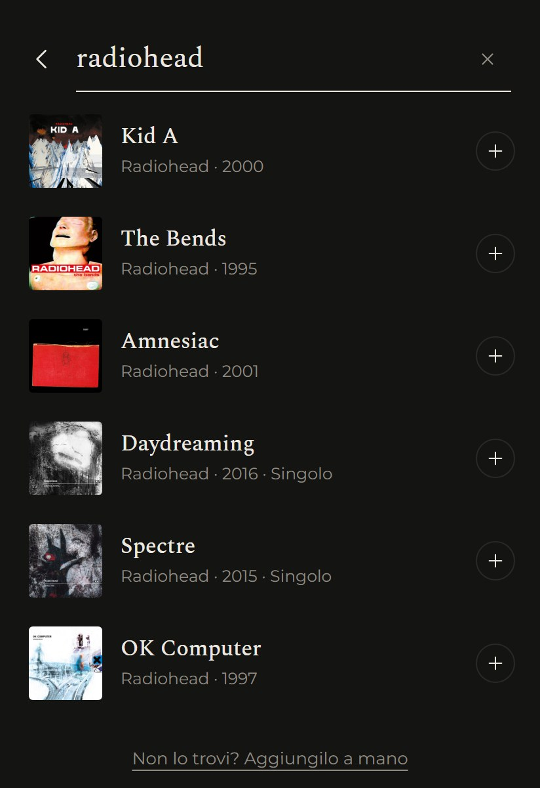</p>

Tocca il resto della riga per l'**anteprima**: copertina grande, fonte, numero di brani, durata, genere ed elenco dei brani (anche per l'album letto da un link, cercandolo su iTunes e Deezer). Serve a scegliere l'edizione giusta prima di aggiungerla.

<p align="center">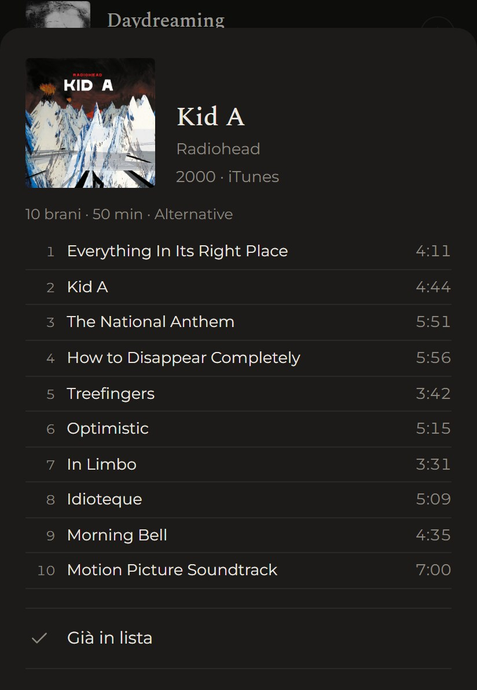</p>

A ricerca vuota trovi le **ricerche recenti**: le ultime otto che hai confermato o da cui hai aggiunto un album. La **x** ne toglie una, *Cancella* le toglie tutte.

<p align="center">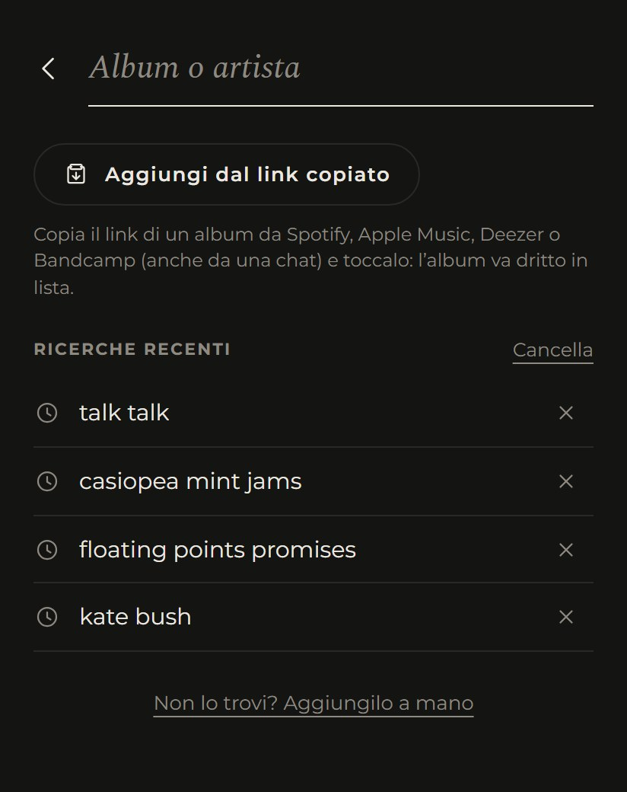</p>

#### Dal link copiato

Copia il link di un album (per esempio da una chat), tocca **+** e poi **Aggiungi dal link copiato**. L'album va dritto in *Da ascoltare*, con *Annulla*. Funziona con link di Spotify, Apple Music, Deezer e Bandcamp; se l'album c'è già, l'app te lo dice.

<p align="center"></p>

#### Da altre app

Da Spotify, Apple Music, Deezer, Bandcamp o dal browser tocca *Condividi* → **Ascolti**. L'album letto dal link compare in cima ai risultati, segnato *dal link*, con sotto la ricerca normale nel caso abbia letto male. Con i siti che non riconosce, l'app cerca il titolo della pagina.

<p align="center">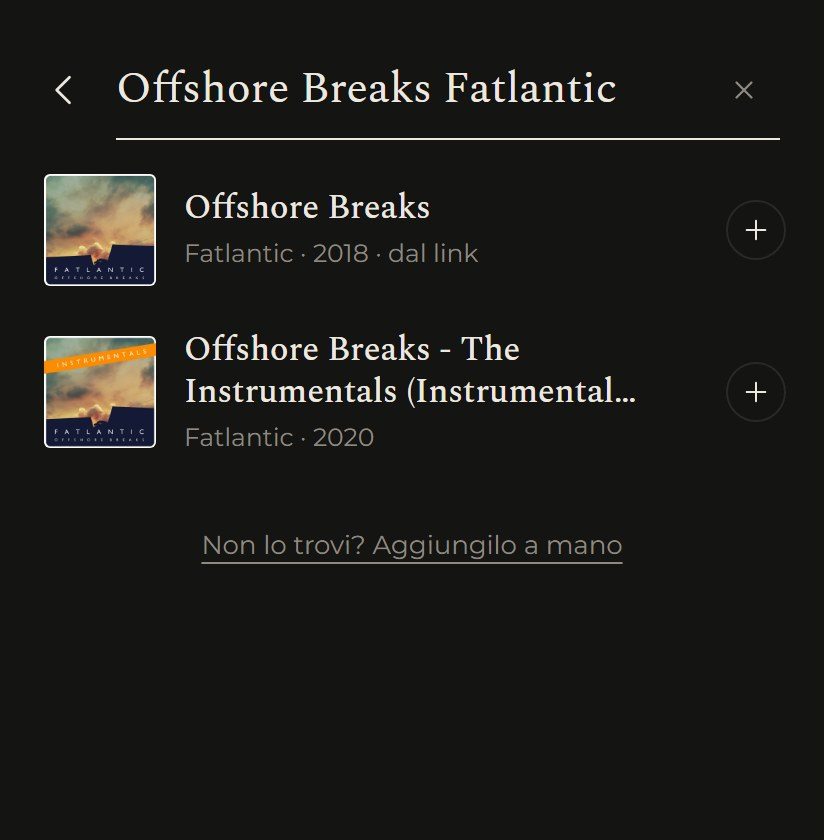</p>

#### A mano

Se non lo trovi: *Non lo trovi? Aggiungilo a mano*. Puoi scegliere anche la copertina tra quelle trovate (vedi [Modifica](#modifica)) e scrivere una [nota](#nota).

### La lista

#### Da ascoltare e Ascoltati

Tocca il cerchio accanto a un album per spuntarlo: passa tra gli *Ascoltati*. Se sbagli, tocca *Annulla*. Mentre scorri, schede, filtro e ordinamento restano in alto.

<p align="center"></p>

#### Annulla

Ogni azione che cambia la lista (spunta, eliminazione, aggiunta) mostra in basso un avviso con **Annulla**: basta toccarlo in un punto qualsiasi. Se fai più azioni di fila gli avvisi si mettono in colonna, ognuno con il suo *Annulla*; ne restano al massimo tre, e il quarto manda via il più vecchio.

<p align="center">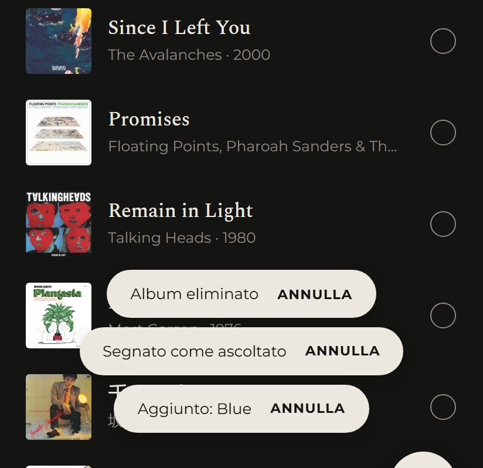</p>

#### Gesti

Nella vista a lista scorri un album **verso destra** per segnarlo come ascoltato (in *Ascoltati*: per rimetterlo da ascoltare) e **verso sinistra** per eliminarlo, sempre con *Annulla*.

<p align="center"></p>

#### Filtra e ordina

Sopra ciascuna lista c'è un campo che filtra mentre scrivi: titolo, artista, anno o nota, anche insieme ("radiohead 2001"). Accanto c'è **Ordina**: aggiunti o ascoltati di recente, artista, titolo, anno dal più vecchio o dal più nuovo. Ogni lista ricorda il suo ordine: per esempio *Da ascoltare* per artista e *Ascoltati* per data. Nell'ordine per artista "The" viene ignorato; gli album senza anno vanno in fondo.

<p align="center">
  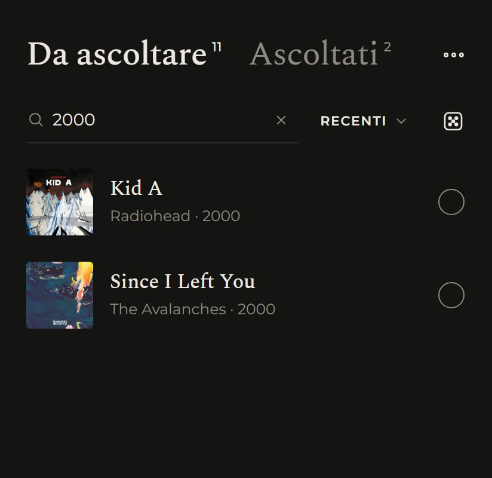
  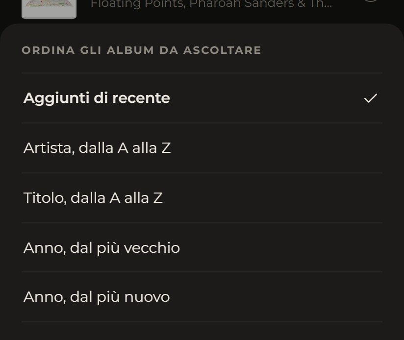
</p>

#### Cosa ascolto adesso?

Il **dado** pesca un album a caso tra quelli da ascoltare (se hai scritto un filtro, tra quelli filtrati). Non ti convince? *Pesca un altro*. Negli *Ascoltati* il dado diventa **Cosa riascolto?**; con il filtro dei preferiti pesca solo tra quelli.

<p align="center">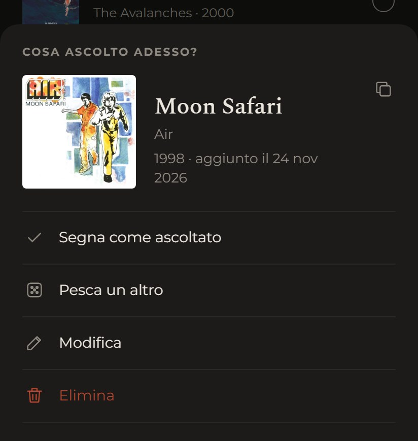</p>

#### Preferiti

Nella scheda di un album ascoltato, **Preferito**, sotto la copertina, lo segna con il cuore. Negli *Ascoltati* i preferiti hanno il cuore accanto all'artista, e il cuore sopra la lista mostra solo quelli.

<p align="center">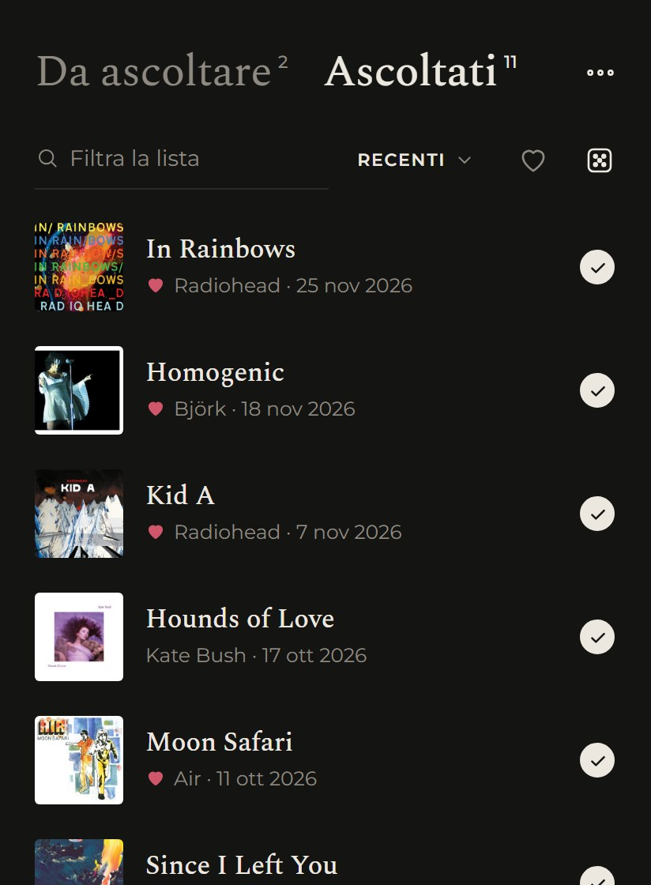</p>

#### Più album insieme

Tieni premuto un album, tocca gli altri (o *Tutti*), poi:

- **✓** per segnarli come ascoltati (negli *Ascoltati*, la freccia li rimette da ascoltare), comodo dopo una giornata di ascolti;
- il **cestino** per eliminarli.

Sempre con *Annulla*.

<p align="center"></p>

#### Lista o schede

Da *Impostazioni → Vista a schede* le copertine si vedono in griglia, 2 o 3 per riga, nel tema scuro o in quello chiaro.

<p align="center">
  
  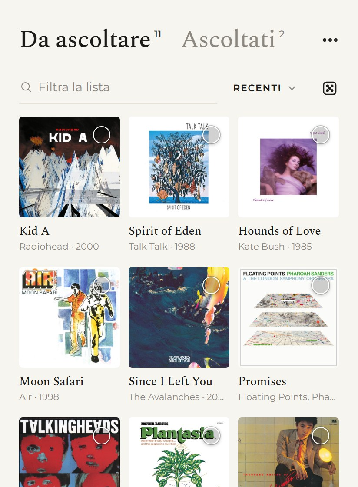
</p>

### La scheda dell'album

Tocca un album per aprirne la scheda: da qui lo segni come ascoltato (o lo rimetti tra quelli da ascoltare), lo copi, lo cerchi, lo modifichi o lo elimini (con *Annulla*).

Questo e gli altri pannelli che arrivano dal basso (modifica, ghiera, menu, anteprime) si chiudono anche **trascinandoli verso il basso**: oltre un quarto della loro altezza, o con un colpo veloce, si chiudono tutti quelli aperti e torni alla lista (o alla schermata da cui eri partito, come le statistiche), senza salvare. I menu di scelta (genere, ordinamento, app di musica) e la ghiera invece chiudono solo sé stessi e ti riportano dove li avevi aperti. Il gesto parte quando il pannello è in cima, da qualsiasi punto (anche da un campo di testo), tranne il cerchio della ghiera.

#### Brani

In fondo alla scheda, la riga **Brani** mostra subito quanti sono e quanto dura l'album; toccala per aprire l'elenco con le durate, che si allunga dentro la scheda (la scheda resta della sua altezza: scorri per vederlo tutto). Ogni scheda si apre con i brani chiusi. I brani arrivano dalla fonte dell'album; per quelli aggiunti a mano o da un link l'app cerca lo stesso album su iTunes e Deezer.

#### Nota

Perché l'avevi aggiunto? *Consigliato da Marco*, *sentito al bar*… La nota compare nella scheda sotto il titolo. Si scrive da *Aggiungi una nota* o da *Modifica*, e il filtro della lista cerca anche nelle note.

<p align="center">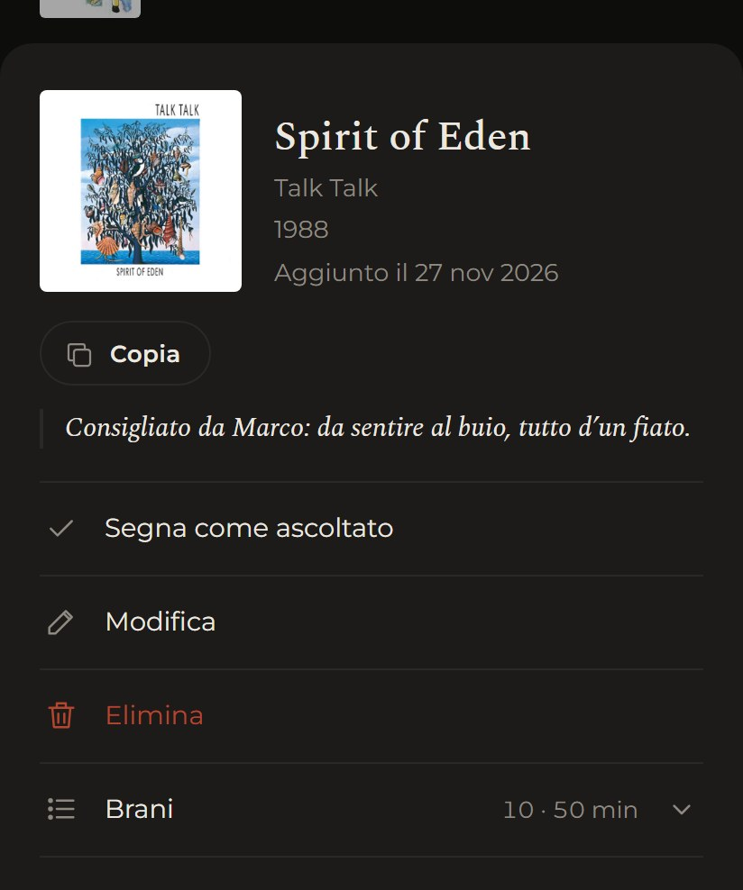</p>

#### Copia e Cerca su …

- **Copia**, sotto la copertina, mette negli appunti artista e titolo, pronti da incollare dove vuoi. È comoda con i nomi in caratteri che non sai scrivere, come i kanji.
- **Cerca su …**: se in *Impostazioni → App di musica* hai scelto la tua app, la apre già sulla ricerca dell'album. Le app disponibili sono Spotify, Apple Music, YouTube Music, Deezer, Tidal, Amazon Music, Bandcamp e SoundCloud; se l'app non è installata si apre il sito.

<p align="center"></p>

#### Modifica

Dalla scheda, *Modifica* allunga il pannello fino in cima. **Annulla**, la freccia in alto e il tasto indietro di Android riportano alla scheda senza salvare.

Titolo, artista, anno, copertina e nota; per gli album ascoltati anche la **data di ascolto**, se l'hai spuntato in ritardo. In fondo ci sono i **brani** e il **genere**. La durata di un brano si sceglie toccando l'orologio accanto al titolo: si apre una **ghiera** che parte da 00:00 e si gira col dito, a scatti di un secondo, con un minuto per ogni giro completo (in senso antiorario si torna indietro). Sotto ci sono −1 min, −1 s, +1 s e +1 min per i brani lunghi e per rifinire. Il genere si sceglie da un menu (le stesse famiglie delle statistiche, più quelli che hai già usato), con *Aggiungi un genere…* in fondo per scriverne uno nuovo. Di solito brani e genere si compilano da soli, ma puoi correggere, aggiungere o togliere brani. Numero di brani e durata dell'album si calcolano dall'elenco, così scheda e statistiche restano coerenti. Un elenco o un genere cambiati a mano l'app non li tocca più. Se hai cambiato l'elenco e vuoi tornare a quello ufficiale, tocca l'icona di ripristino accanto a *Brani*: l'app lo cerca di nuovo e, se lo trova, lo rimette nel modulo (diventa definitivo con *Salva*). **Scegli copertina** cerca su iTunes, Deezer e MusicBrainz e ti mostra quelle trovate: tocca quella che vuoi.

<p align="center">
  
  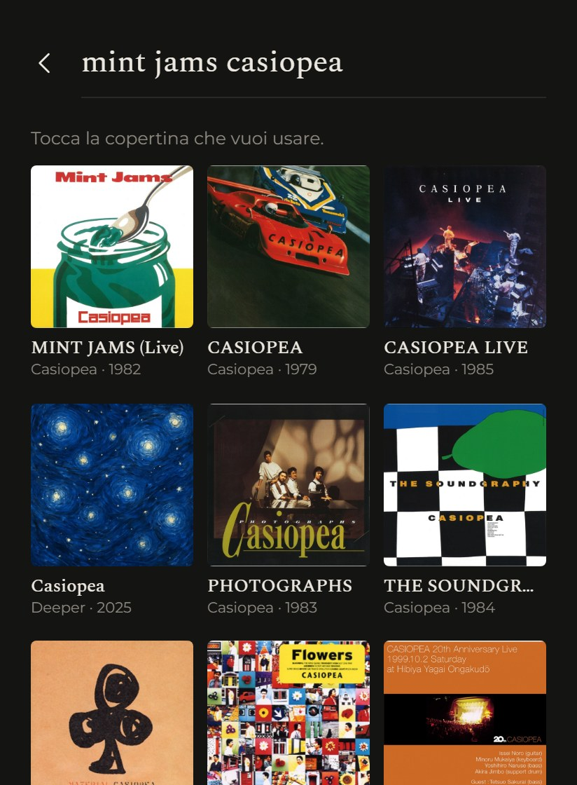
</p>

<p align="center">
  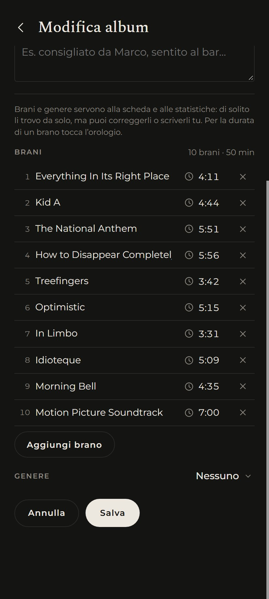
  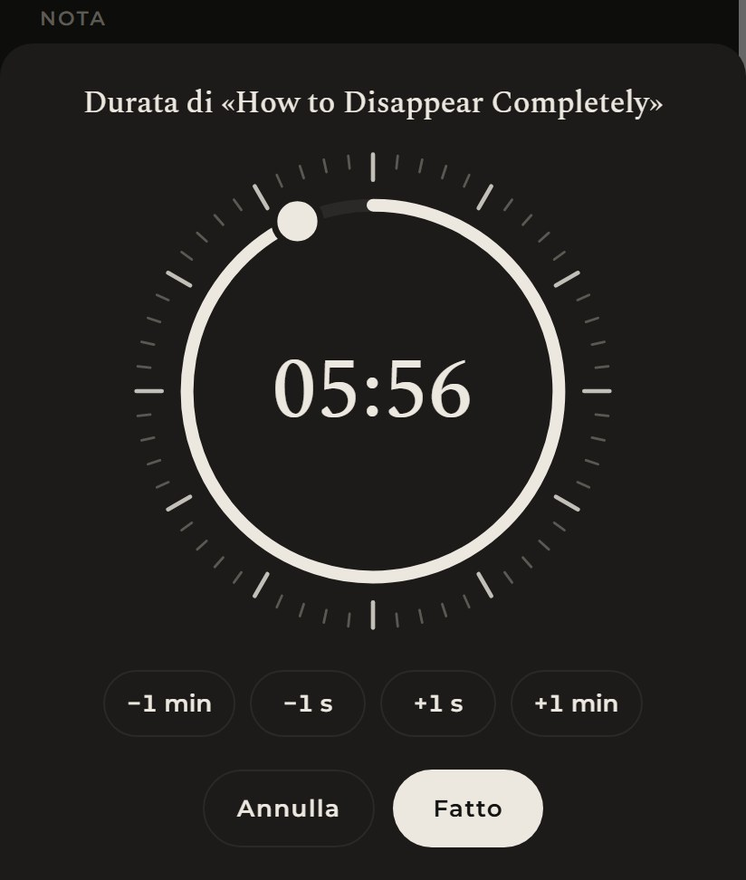
</p>

### Statistiche

Da *Impostazioni → Statistiche*:

- **Tempo**: le ore di musica ascoltate e quelle ancora in lista, con qualche paragone: "2,3 giorni di fila, senza dormire", "un'ora al giorno: 3 mesi" e, per entrambe, uno che cambia ogni volta che apri le statistiche, pescato tra una quarantina ("Come guardare 9,6 volte *Il Signore degli Anelli*", "Come andare 13 volte da Milano a Roma in Frecciarossa", "Come preparare 730 volte le uova sode"…). Ogni album conta una volta, dall'inizio alla fine.
- **Ascoltati per mese** nell'ultimo anno, in album o in ore (tocca una colonna per leggerne il valore).
- **Il ritmo della lista**: quanti album aggiungi e quanti ne ascolti al mese, e quando svuoterai la lista (se la svuoterai).
- **Prima di ascoltarli**: quanto tempo passa, in media, tra quando aggiungi un album e quando lo ascolti.
- **In attesa da più tempo**: i tre album in lista da più tempo. Tocca per aprirne la scheda.
- **Il più lungo e il più corto** tra quelli ascoltati.
- **Decenni**: in che anni è uscita la musica che ascolti e che hai in lista, e quanti anni dopo la ascolti.
- **Generi**, raccolti in famiglie (iTunes e Deezer li chiamano in modi diversi).
- **Abitudini**: da quante settimane di fila ascolti qualcosa, il record, e il giorno in cui spunti più album.
- **Artisti più presenti**.

<p align="center">
  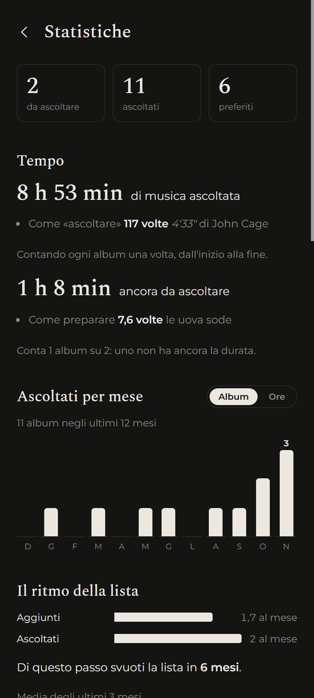
  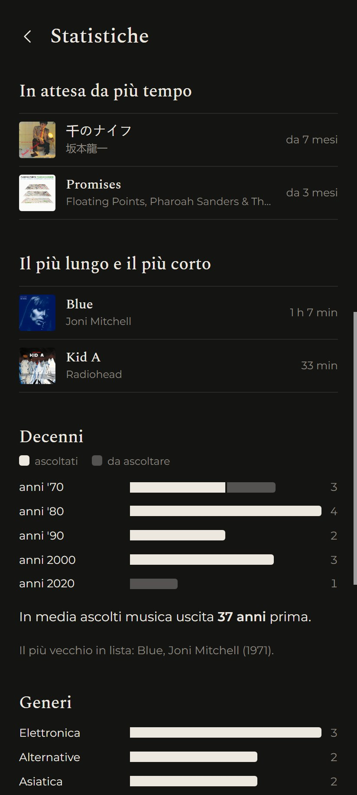
  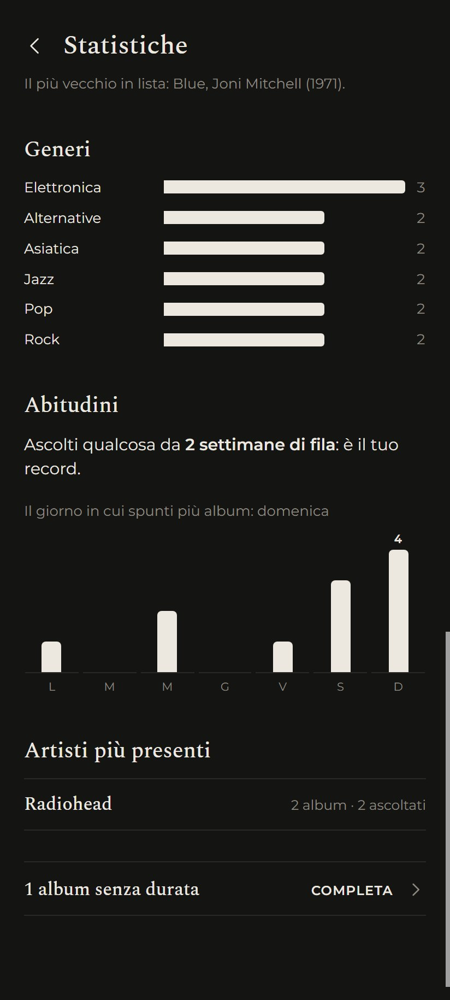
</p>

Brani, durata e genere l'app li cerca da sola, in background, con le stesse fonti della riga *Brani*. Se per qualche album non li trova, in fondo alle statistiche compare **N album senza durata · Completa**: tocca un album e aggiungi tu i brani (vedi [Modifica](#modifica)). È facoltativo: senza, quell'album resta fuori dai conti del tempo.

<p align="center">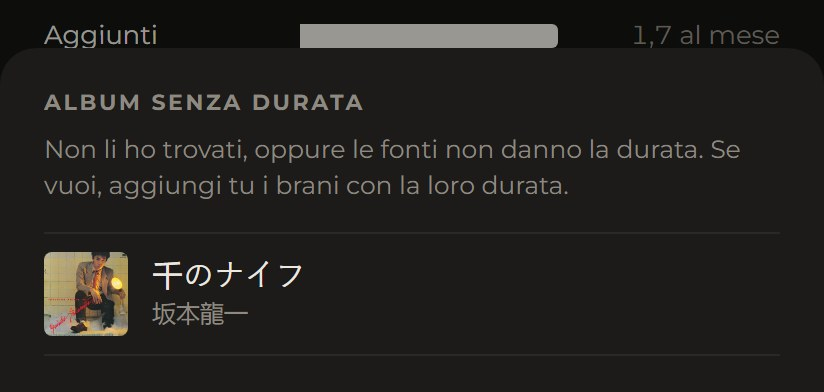</p>

### Impostazioni

Dai tre puntini in alto a destra:

- **Statistiche** (vedi sopra).
- **Tema** e **Testo** (vedi sotto).
- **Vista a schede** e **Schede per riga**.
- **App di musica** per *Cerca su …* (predefinito: nessuna).
- **Backup** e **Aggiornamenti** (vedi sotto).

<p align="center"></p>

#### Tema e testo

- **Tema**: scuro (predefinito), chiaro o **Sistema**, che segue il tema scuro del telefono.
- **Testo**: quattro dimensioni dei caratteri, dalla più piccola alla più grande. Cambia solo il testo, non copertine e pulsanti.

#### App di musica

Tocca il nome dell'app e scegli dal pannello quella in cui aprire *Cerca su …*.

<p align="center">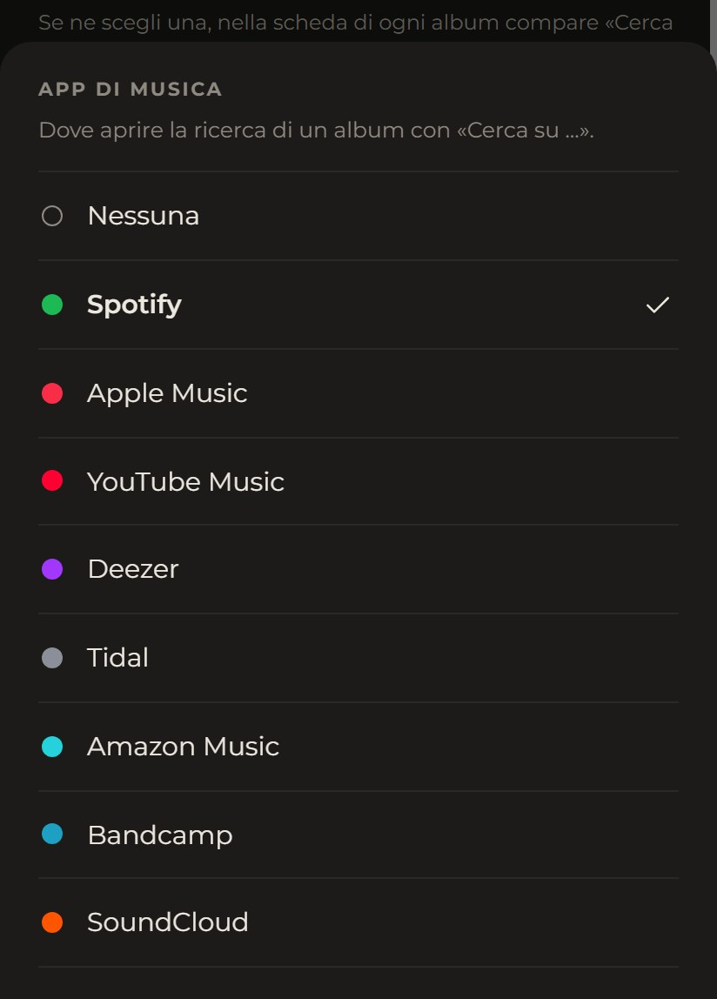</p>

## Installazione

Ascolti non è sul Play Store: si installa scaricando il file dell'app (un APK) da questa pagina. Serve **Android 7 o più recente**.

1. **Sul telefono**, apri la pagina **[dell'ultima versione](https://github.com/dariotronic/ascolti-todo/releases/latest)** e tocca il file **`Ascolti.apk`** in fondo, sotto *Assets*.
2. Quando il download è finito, tocca la notifica o apri il file dai *Download*.
3. La prima volta Android ti chiede di **consentire l'installazione di app da questa origine** (il browser, per esempio Chrome): tocca *Impostazioni*, attiva *Consenti da questa origine* e torna indietro.
4. Tocca **Installa**.
5. Probabilmente comparirà **Google Play Protect** (vedi sotto). Se decidi di procedere, tocca *Altri dettagli* → **Installa comunque**.
6. Apri **Ascolti** e tocca **+** per aggiungere il primo album.

### L'avviso di Play Protect

Play Protect controlla le app che non arrivano dal Play Store. Con Ascolti può mostrare *"App non riconosciuta"* oppure *"App dannosa bloccata"*.

Google non spiega il secondo avviso, che spaventa, ma il motivo più probabile è questo: Ascolti sa **scaricare e installare i propri aggiornamenti** senza passare dal Play Store, e i controlli automatici di Google trattano con sospetto le app installate a mano che lo fanno. L'app può installare **solo una versione più nuova di sé stessa**, firmata con la stessa chiave e presa da questa pagina.

Non legge contatti, foto, posizione o altri dati del telefono. **Il codice è tutto pubblico, qui.** Detto questo, la scelta è tua: se l'avviso ti mette a disagio, non installarla.

### Aggiornamenti

Quando apri l'app, Ascolti controlla se c'è una versione nuova, al massimo una volta l'ora. Se c'è, in cima alla lista compare **"Nuova versione disponibile · Aggiorna"**. Tocca *Aggiorna*: l'app la scarica, mostra l'avanzamento e apre l'installazione, senza perdere i dati.

- La prima volta Android ti chiede di **consentire ad Ascolti di installare app**: attiva l'opzione e torna indietro, l'installazione riparte da sola.
- Anche qui può comparire Play Protect: *Altri dettagli* → *Installa comunque*.
- Puoi controllare anche a mano da *Impostazioni → Controlla aggiornamenti*.
- **Novità** nell'avviso mostra l'elenco di cosa cambia, prima di aggiornare. Al primo avvio dopo l'aggiornamento, l'elenco si apre da solo, una volta.

<p align="center">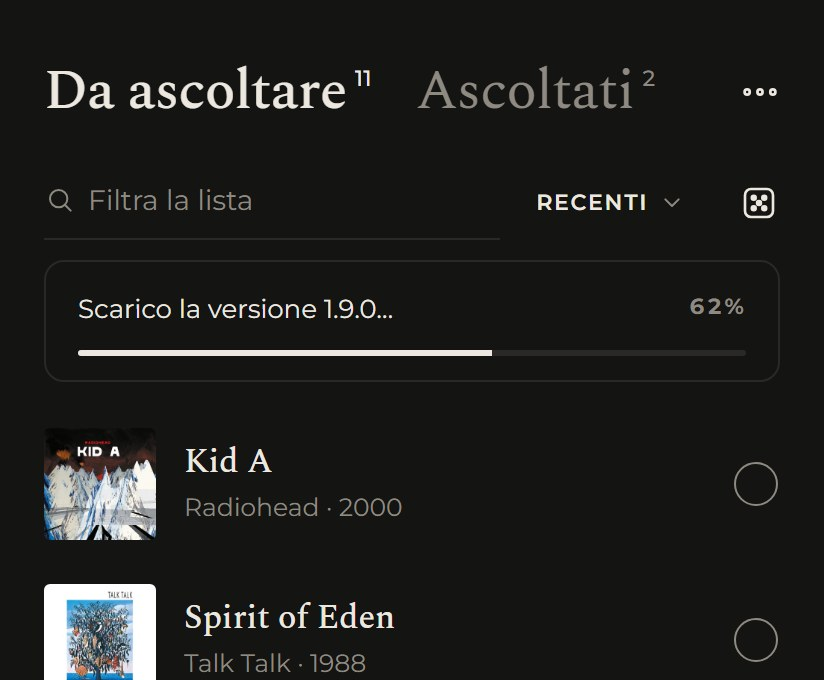</p>

### Backup e cambio di telefono

I dati stanno **sul telefono**. Se nel telefono è attivo il backup di Google, Android può includere lista e impostazioni di Ascolti nel suo backup automatico e nel passaggio a un telefono nuovo, ma non è garantito: per un'app installata fuori dal Play Store dipende dal telefono. Se disinstalli l'app o ne cancelli i dati, la lista si perde. Per avere una copia sicura, da *Impostazioni → Backup*:

- **Salva in Documenti**: crea il file `ascolti-backup-AAAA-MM-GG.json` nella cartella *Documenti/Ascolti* del telefono.
- **Condividi…**: manda lo stesso file dove vuoi (Drive, mail, Telegram…).
- **Ripristina da un file**: scegli un file di backup, anche su un altro telefono. Gli album già presenti non vengono duplicati.

Se non fai un backup da più di un mese, l'app te lo ricorda in cima alla lista (*Più tardi* lo rimanda di una settimana).

### Privacy

- Niente account, niente pubblicità, niente statistiche d'uso. La lista resta sul telefono.
- Quando cerchi, il testo che scrivi viene inviato ad Apple (iTunes), Deezer e MusicBrainz per trovare gli album; da lì arrivano anche le copertine e l'elenco dei brani (nell'anteprima e nella scheda; per gli album aggiunti a mano o da un link, artista e titolo vengono cercati su iTunes e Deezer). Le ricerche recenti restano sul telefono.
- Le copertine degli album in lista vengono salvate sul telefono, così si vedono anche senza rete.
- Quando aggiungi da un link (copiato o condiviso), l'app apre quella pagina per leggerne titolo, artista, anno e copertina.
- Gli appunti vengono letti solo quando tocchi *Aggiungi dal link copiato*; con *Copia* l'app ci scrive artista e titolo.
- *Cerca su …* apre la tua app di musica (o il suo sito) con artista e titolo dell'album.
- Per gli aggiornamenti l'app legge l'elenco delle versioni da GitHub.

### Riconoscimenti

Dati degli album da [iTunes Search](https://performance-partners.apple.com/search-api), [Deezer](https://developers.deezer.com/api), [MusicBrainz](https://musicbrainz.org) e [Cover Art Archive](https://coverartarchive.org). Caratteri [Spectral](https://fonts.google.com/specimen/Spectral) e [Montserrat](https://fonts.google.com/specimen/Montserrat) (licenza SIL Open Font).

Made with 🪗 by [@dariotronic](https://www.instagram.com/dariotronic/).

---

# Per chi sviluppa

App [Capacitor 8](https://capacitorjs.com) con HTML, CSS e JS senza framework e senza bundler, in `www/`. Pacchetto Android `it.dariotronic.ascolti`.

## Struttura

- `www/`: l'app (`index.html`, `style.css`, `app.js`, caratteri in `fonts/`). `lib.js` contiene le funzioni pure (ricerca, lettura dei link, versioni) e viene caricato prima di `app.js`, che le usa come globali; in Node le esporta per i test. Per vedere l'app basta aprire `index.html` nel browser; lì i dati finiscono in `localStorage` e i plugin nativi mancano: niente aggiornamenti né Condividi, il backup si scarica e le copertine non vengono salvate.
- `test/`: test di `lib.js` (vedi [Test](#test)).
- `www/novita.js`: le novità di ogni versione, in markdown semplice. L'app le mostra al primo avvio dopo l'aggiornamento; `release.sh` le pubblica come testo della release, da cui l'avviso "Nuova versione disponibile" le legge (pulsante *Novità*).
- `android/`: il progetto Android generato da Capacitor, con due plugin dell'app (non da npm), registrati in `MainActivity.java`:
  - [`ApkUpdaterPlugin.java`](android/app/src/main/java/it/dariotronic/ascolti/ApkUpdaterPlugin.java): scarica e installa gli aggiornamenti (vedi sotto).
  - [`ShareReceiverPlugin.java`](android/app/src/main/java/it/dariotronic/ascolti/ShareReceiverPlugin.java): riceve il testo condiviso da altre app (*Condividi → Ascolti*, intent `SEND` `text/plain`). Lo passa al JavaScript con `consume()` all'avvio e con l'evento `shared` ad app aperta.
  - `build.gradle` ricava `versionName`/`versionCode` da `package.json` (1.2.3 → 10203).
- `.github/workflows/release.yml`: compila, firma e pubblica le release.
- `build.sh` / `release.sh`: compilazione locale e avvio del workflow di release.

Plugin di Capacitor usati: `App`, `Preferences` (dati e impostazioni), `Filesystem` e `Share` (backup, copertine salvate), `Clipboard` (copia e link copiato). Il `fetch` passa da `CapacitorHttp`, che evita i limiti CORS. Ogni richiesta di rete ha un tempo massimo (10 secondi, 12 per le pagine dei link): una fonte che non risponde non blocca la ricerca.

Permessi Android: `INTERNET`, `REQUEST_INSTALL_PACKAGES` (aggiornamenti) e, solo fino ad Android 10, lettura e scrittura della memoria per il backup in Documenti. Il FileProvider espone solo `cache/updates` e `cache/backup`.

## Dati

In `Preferences`, cioè nelle SharedPreferences `CapacitorStorage.xml`:

- `albums.v1`: la lista. Ogni album ha `id` (`fonte:id`, per esempio `itunes:1097862870`, `link:open.spotify.com/album/…`, `manual:<ora>`), `title`, `artist`, `year`, `cover`, eventualmente `coverAlt`, `type`, `note` e `fav`, più `addedAt` e `listenedAt` (millisecondi; `null` = da ascoltare). `coverFile` e `coverFileOf` indicano la copertina salvata (vedi sotto) e non finiscono nel backup su file. Per le statistiche: `trackCount`, `durationMs` e `genre`, cercati in background (`enrichAlbums`, una volta per album; `infoTried` = ultimo tentativo, un album non trovato si riprova dopo 30 giorni) oppure ricavati dall'elenco dei brani scritto o corretto in Modifica (`tracks: [{ title, ms }]`, che da quel momento è l'elenco mostrato ovunque e non si ricerca più; vuoto = nessun brano). Il ripristino dell'elenco ufficiale (icona accanto a *Brani* nel modulo) cancella `tracks` e rimette numero e durata trovati in automatico. `genreManual` indica un genere scritto a mano. Se cambi titolo o artista, i dati trovati in automatico si cancellano e si ricercano. I dati della versione di prova con numeri scritti a mano senza elenco (`infoManual`) vengono convertiti all'avvio: i numeri si ricercano, il genere resta.
- `settings.v1`: impostazioni (`theme`, `fontScale`, `view`, `cols`, `sortTodo`, `sortDone`, `musicApp`, date del backup). Le versioni fino alla 1.8 avevano un solo `sort`: all'avvio viene copiato nei due nuovi.
- `searches.v1`: le ricerche recenti. `update.v1`: l'ultimo controllo degli aggiornamenti.

Due album sono lo stesso album se hanno lo stesso `id` oppure le stesse parole in titolo e artista (`sameAlbum` in `lib.js`). Questo vale per la ricerca, il link copiato, l'aggiunta a mano e il ripristino.

Il backup automatico di Android è limitato a `CapacitorStorage.xml` (`res/xml/data_extraction_rules.xml` per Android 12+, `backup_rules.xml` per le versioni precedenti). Le copertine salvate restano fuori: si riscaricano.

Se il salvataggio non riesce, l'app lo dice con un avviso (al massimo uno ogni 10 secondi) invece di perdere le modifiche senza dire niente.

## Ricerca

Le tre fonti (iTunes Search, Deezer, MusicBrainz) vengono interrogate in parallelo, 25 risultati ciascuna, e la lista si aggiorna man mano che rispondono. Lo stesso album trovato su più fonti diventa un solo risultato: copertina da iTunes o Deezer, anno più vecchio, cioè quello dell'uscita originale. L'ordine dipende da:

- quante parole cercate compaiono in titolo e artista;
- titolo senza parole in più;
- edizioni (*Live*, *Remastered*, anni…) subito sotto l'album;
- singoli ed EP dopo gli album;
- album conosciuti da più fonti prima.

MusicBrainz accetta una richiesta al secondo: se risponde 503, l'app riprova una volta.

## Lettura dei link

Usata da *Aggiungi dal link copiato* e da *Condividi → Ascolti*. L'app scarica la pagina presentandosi come Chrome per Android e ne legge i metadati (`og:title`, `og:description`, `og:image`, `music:release_date`), con regole diverse per Spotify (album e brani), Apple Music, Deezer e Bandcamp.

- Il sito si riconosce dal link, non dall'indirizzo finale: dal telefono Spotify può reindirizzare a `spotify.app.link`.
- Dai link di Spotify si toglie `?si=…` e si aggiunge `nd=1`, così la pagina non rimanda all'app.
- L'identità di un link ignora parametri e `intl-xx`, così lo stesso album copiato due volte risulta già in lista.
- Per gli altri siti, o se la pagina non si legge (Bandcamp a volte risponde con un controllo anti-bot), si cerca il titolo della pagina o le parole dell'indirizzo.

## Copertine salvate

In background l'app scarica una alla volta le copertine degli album in lista (`CapacitorHttp`, `responseType: 'blob'`) e le salva in `files/covers/` (`Directory.Data`), con un nome ricavato dal link. Nella pagina l'immagine punta al file tramite `Capacitor.convertFileSrc`, con il link in rete e la copertina di riserva come alternative (`data-alts`) se il file non si carica. All'avvio i file che nessun album usa più vengono cancellati, e gli album il cui file manca (per esempio dopo un ripristino) lo riscaricano. Un link che non si scarica non viene riprovato fino al prossimo avvio.

## Test

```bash
npm test
```

Prova con `node --test` le funzioni di `www/lib.js`: lettura delle pagine di Spotify (album e brano), Apple Music, Deezer e Bandcamp, pulizia dei link, riconoscimento dei doppioni, classifica e unione dei risultati, confronto delle versioni, famiglie di generi e settimane di fila. Le pagine in `test/fixtures/` sono estratti veri, con i soli metadati. Quando un sito cambia il suo markup, riscarica la pagina, rifai l'estratto e guarda quale test si rompe. Il workflow di release lancia i test prima di compilare.

## Aggiornamenti dentro l'app

All'avvio (e al ritorno in primo piano, al massimo una volta l'ora) l'app legge l'ultima release di questa repo. Il plugin può installare **solo una versione più nuova di Ascolti stessa**:

- scarica solo dalle release di `dariotronic/ascolti-todo` (file `.apk`, al massimo 100 MB);
- confronta l'impronta SHA-256 dichiarata da GitHub;
- prima di installare controlla nome del pacchetto, versione e firma;
- installa solo file della propria cartella degli aggiornamenti.

## Pubblicare una nuova versione

La release si compila e si firma su GitHub Actions ([`release.yml`](.github/workflows/release.yml)), con la chiave salvata nei secret della repo: non serve un PC in particolare.

- **Dal sito**: *Actions* → *Release* → *Run workflow*, scrivi versione (es. `1.9.0`) e note.
- **Da Git Bash**, dopo aver fatto commit delle modifiche e scritto le novità della versione in `www/novita.js`:

  ```bash
  ./release.sh 2.1.0
  ```

  Senza secondo argomento le note della release sono quelle di `www/novita.js` per quella versione; si possono anche passare a mano (`./release.sh 2.1.0 "Cosa cambia"`).

Il workflow:
1. aggiorna la versione in `package.json`;
2. lancia i test (`npm test`) e compila;
3. verifica che l'APK sia firmata con la chiave di Ascolti;
4. fa commit e tag `vX.Y.Z`;
5. crea la release con `Ascolti.apk` allegata.

Con *Solo prova* compila e verifica senza pubblicare.

Secret della repo: `KEYSTORE_BASE64` (il file `.jks` in base64), `KEYSTORE_PASSWORD`, `KEY_ALIAS`, `KEY_PASSWORD`.

## Compilare in locale

Servono JDK 21 e Android SDK (platform 36). Poi `./build.sh` produce `Ascolti.apk`, firmata se sul PC c'è la chiave (vedi sotto).

Per installarla via USB: `adb install -r Ascolti.apk`.

Per fare debug della WebView su una build firmata, aggiungi temporaneamente `"android": { "webContentsDebuggingEnabled": true }` a `capacitor.config.json`, compila con `./build.sh` e collegati da `chrome://inspect`. Poi togli l'opzione: le release non devono averla.

## Screenshot del README

Le immagini in `docs/screenshots/` sono l'app vera (`www/`) con dati di esempio, catturata da Edge senza finestra con uno schermo da telefono emulato (412 px, densità 2):

```bash
node tools/screenshots/capture.mjs "$PWD/www" "$PWD/docs/screenshots" "$PWD/tools/screenshots/demo.json"
```

Per rifare solo alcune scene aggiungi i loro nomi in fondo, separati da virgole (es. `18-nota,20-statistiche`). Gli errori JavaScript della pagina vengono stampati mentre cattura. `demo.json` contiene gli album di esempio, con le copertine da iTunes. `extra.json` contiene i risultati di ricerca e le copertine mostrate nelle schermate di ricerca. Le scene, cioè cosa aprire e quale zona ritagliare, sono in fondo a `capture.mjs`.

## Firma

Le release sono firmate con una chiave dedicata, **tenuta fuori dalla repo**: `ascolti-todo-release.jks` più `keystore.properties` con le password. Gradle la cerca in `~/.keystores/ascolti-todo/keystore.properties`, oppure nel percorso indicato dalla variabile `ASCOLTI_KEYSTORE_PROPS`.

La stessa chiave è nei secret della repo per il workflow, ma da lì **non si può rileggere**: tienine una copia di sicurezza. Senza la stessa chiave gli aggiornamenti non si installano sopra l'app esistente.
